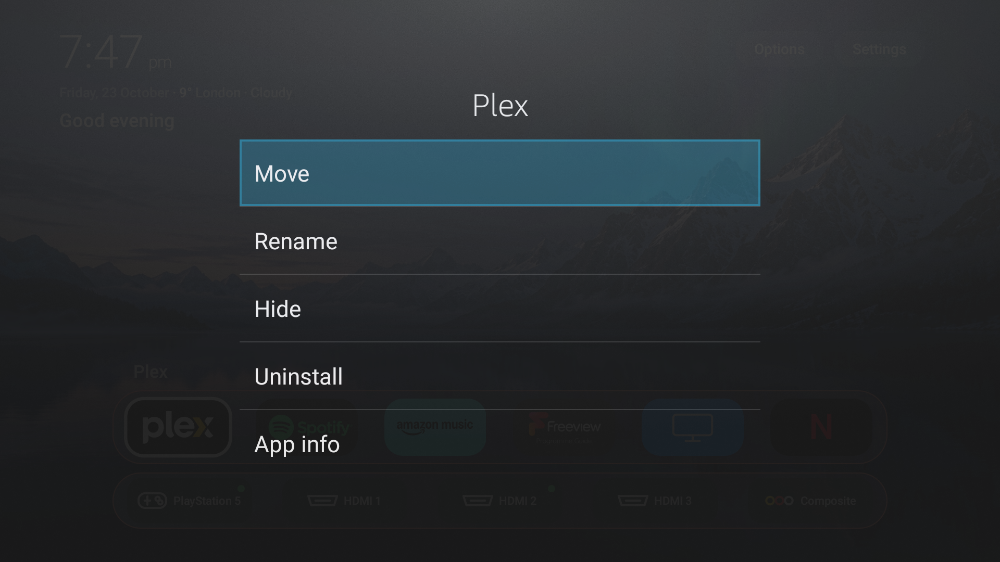

# TV-Debloater

[](https://github.com/mahirm380/TV-Debloater/actions/workflows/validate.yml)
[](https://github.com/mahirm380/TV-Debloater/releases/tag/launcher-v2.1)
[](LICENSE)

An open-source, Apple TV-inspired home screen for Fire TV, Android TV and Google
TV, plus the proven privacy cleanup from
[humblemuzzu/dumbtv](https://github.com/humblemuzzu/dumbtv).

It keeps the useful parts of a television—apps, Live TV, HDMI inputs, casting and
the app store—while replacing the noisy home screen with a fast, quiet dock. It
does not root the TV, flash firmware or replace the operating system.

> [!IMPORTANT]
> Full cleanup automation is for **Fire OS 6, 7 and 8**. The launcher can also be
> installed on many **Android TV and Google TV** devices with ADB, but some brands
> do not allow a third-party app to become the permanent Home screen. Samsung
> Tizen, LG webOS, Roku and VIDAA do not run Android APKs. See
> [compatibility](#compatibility) before starting.


_Real 1920×1080 screenshot from a TCL 50T6C-UK Fire TV. No mock-up and no personal
network identifiers._

▶ **[Watch the 19-second demo](https://github.com/mahirm380/TV-Debloater/releases/download/launcher-v2.1/tv-debloater-demo-landscape.mp4)** ·
**[Download the vertical version](https://github.com/mahirm380/TV-Debloater/releases/download/launcher-v2.1/tv-debloater-demo-vertical.mp4)** ·
**[Share the poster](https://github.com/mahirm380/TV-Debloater/releases/download/launcher-v2.1/tv-debloater-launch-poster.png)**

If it works on your TV, please star the repository and add your model to the
[community device-testing thread](https://github.com/mahirm380/TV-Debloater/issues/1).

## Install it with one prompt

You only do two things:

1. Turn on ADB/Wireless debugging on the TV and find its IP address.
2. Paste the prompt below into an AI that can control a terminal on your computer,
   such as **Codex, Claude Code, Cursor, Gemini CLI, or ChatGPT/Claude with computer
   and terminal tools**.

Replace **only** `[TV IP ADDRESS]`. The AI downloads this project and does the
computer work for you.

```text
I own the TV at [TV IP ADDRESS]. ADB/Wireless debugging is already enabled and the
TV is on the same private network as this computer. Set it up using
https://github.com/mahirm380/TV-Debloater.

Do all of the computer work for me: download the repository, obtain Android ADB
from the official source if it is missing, connect to the TV, detect its model and
operating system, and read AGENTS.md and docs/AI-SETUP.md before changing anything.
Do not ask me to clone anything, install tools, or type terminal commands myself.

I want the Apple TV-style home screen shown in the repository. Keep Live TV, every
HDMI input, casting/AirPlay, the official app store, and all installed user apps.
Use safe defaults and leave remote-button remapping off unless I request it. Run a
read-only compatibility check first, show me a short summary, and ask once before
the first change. I will use the TV remote only to accept its debugging prompt or
choose dumbtv home if the TV asks.

Never root, flash, factory-reset, unlock the bootloader, write to /system, or guess
model-specific package removals. If this TV is not safely supported, stop and
explain why. When finished, configure the launcher, verify Home, apps, Live TV,
HDMI inputs and the app store, then give me the restore command.
```

That is the whole computer-side setup. The AI may ask your city for weather, ask
what optional Fire OS cleanup you want, or tell you to approve the connection on
the TV. A normal browser chat with no terminal/computer access can explain the
process but cannot connect to a television; choose its coding/agent mode.

See the illustrated [two-step setup guide](docs/INSTALL-GUIDE.md). The instructions
the AI follows are in [docs/AI-SETUP.md](docs/AI-SETUP.md).

## What it will do to your TV

The appearance-only install:

- Adds this lightweight home-screen app. It displays the apps already installed
  on your TV; it does not provide paid apps or bypass subscriptions.
- Shows HDMI and other hardware inputs that the TV exposes through Android's TV
  input system. Live TV remains installed.
- Adds a clock, date, time-aware greeting and optional weather from Open-Meteo.
- Includes three wallpapers, optional slow live motion and support for your own
  photos.
- Keeps an Appstore/Play Store tile when the TV exposes one.
- Can optionally remap branded remote buttons. Remapping is **off by default** and
  is configured for the specific remote only after the owner asks.
- Lets the owner uninstall downloaded apps from a tile's hold-OK/Menu screen,
  with both a launcher warning and the TV's normal system confirmation. Firmware
  apps remain protected.

The optional Fire OS cleanup also:

- Disables ad, sponsored-content, telemetry, ACR and experiment packages. Packages
  are disabled for the current user, not deleted from the system.
- Turns off ad tracking, usage reporting and promotional autoplay.
- Can run an on-TV DNS filter to block Amazon telemetry and update hosts.
- Can switch off Alexa, remove an app or replace YouTube only when the owner says
  so by name.

Every repository change is reversible with `./scripts/restore.sh -y`. The launcher
alone is undone with `./launcher/install.sh --undo`.

## What the finished interface looks like

| Home screen | Wallpaper choices |
|---|---|
|  |  |




Hold OK or press Menu on a downloaded app to move, rename, hide, uninstall or
open its system information. Uninstalling requires a launcher warning followed
by the TV's own confirmation; the action is not shown for firmware apps.

The dock scrolls one complete tile at a time, shows the selected app's name, and
keeps the inputs in a separate aligned row. The greeting changes between morning,
afternoon, evening and night.

## Before pasting the prompt

**Fire TV:** Settings → My Fire TV (or Device & Software) → About → press OK on
the device name seven times → Developer Options → turn **ADB debugging** on. Find
the IP under About → Network.

**Android/Google TV:** Settings → System → About → press Build seven times →
Developer options → turn on **Wireless debugging** or **Network debugging**. Use
the connection address shown there.

Keep the computer and TV on the same private home network. Leave the remote nearby
because the TV will ask you to approve the computer. The AI handles everything
else. Advanced users can still find the individual commands in
[launcher/README.md](launcher/README.md) and the other technical guides.

## Compatibility

| Television platform | Apple-style launcher | Automated cleanup | Important limit |
|---|---:|---:|---|
| Fire OS 6–8 | Yes, tested | Yes | Fire OS 5 and older are refused |
| Android TV / Google TV, Android 7.1+ | Usually | No; use the separate reviewed device lists | Some vendors block replacement Home apps |
| Samsung Tizen | No | No | Does not run Android APKs |
| LG webOS | No | No | Developer mode installs webOS apps only |
| Roku TV | No | No | Developer mode does not provide a shell |
| Hisense VIDAA / Philips Saphi | No | No | Not Android; no owner ADB shell |

“It has developer mode” does not always mean “it can run this launcher.” The
full platform explanation and useful alternatives are in
[docs/OTHER-TVS.md](docs/OTHER-TVS.md).

## Personalising the launcher

Everything visible can be changed with the TV remote under **Options**:

- accent colour and tile size;
- built-in or personal wallpaper;
- still or slow live motion;
- image dimming and wallpaper rotation;
- which apps and inputs appear;
- app/input order and names (hold OK or press Menu on a tile).

Weather and optional remote shortcuts are configured from the computer:

```sh
./launcher/configure.sh --help
```

The settings file is
`/sdcard/Android/data/tv.dumbtv.home/files/home.conf`. Unknown keys are kept, so
updating the launcher does not erase personal choices. See
[launcher/README.md](launcher/README.md) for every setting.

## Safety and privacy

- No root, bootloader unlock, firmware flashing, factory reset or `/system` write.
- No account passwords are requested or stored.
- No IP address, Wi-Fi name, hardware serial or account email belongs in an issue
  or commit. The screenshots here contain none.
- The launcher has no ads, analytics, account system or update checker. Its only
  network request is the optional current-weather request to Open-Meteo.
- AirPlay works only when the television already provides an AirPlay receiver.
  This project does not emulate, bypass or add Apple's protected receiver service.
- Use it only on a television you own or are authorised to manage.

Read [SECURITY.md](SECURITY.md), [docs/HOW-IT-WORKS.md](docs/HOW-IT-WORKS.md) and
[docs/TROUBLESHOOTING.md](docs/TROUBLESHOOTING.md) before changing an unknown
model manually.

## Undo

Launcher only:

```sh
./launcher/install.sh --undo
adb uninstall tv.dumbtv.home     # optional: remove the app too
```

Full Fire OS cleanup:

```sh
./scripts/restore.sh -y
```

The restore script re-enables packages, removes network rules and gives HOME back
to the stock launcher. Apps the owner explicitly asked to uninstall must be
reinstalled from the device's official app store.

## Tested example

The interface shown above was installed and verified on a **TCL 50T6C-UK Fire
TV**, Fire OS 8 / Android 11, over Wi-Fi ADB. Live TV, HDMI inputs, the Amazon
Appstore, AirPlay, Plex and Spotify were retained. The device report is at
[catalog/devices/fireos-tcl-50t6c-uk.yaml](catalog/devices/fireos-tcl-50t6c-uk.yaml).

Other verified devices are listed under [catalog/devices](catalog/devices/). A
successful report from one model is evidence for that build, not a promise about
every television carrying the same brand.

## Build and verify from source

The launcher is plain Java with no Gradle dependencies. It targets Android 7.1 so
one APK covers Fire OS 6–8 and compatible Android TV devices.

```sh
./launcher/build.sh
python3 -m unittest discover -s tests
python3 catalog/validate.py
for file in scripts/*.sh launcher/*.sh; do bash -n "$file"; done
```

Detailed build instructions are in [launcher/README.md](launcher/README.md).

## Credits, licence and trademarks

This is a customised fork of
[humblemuzzu/dumbtv](https://github.com/humblemuzzu/dumbtv). The privacy scripts,
safe package lists, restore flow, device catalog and original launcher architecture
come from that project and its contributors. Android/Google TV research also draws
on [Gathin23/cleanyourtv](https://github.com/Gathin23/cleanyourtv).

Code and documentation are provided under the [MIT licence](LICENSE); device
catalog reports use [CC BY-SA 4.0](catalog/LICENSE). The bundled wallpapers are
project assets. Apple, Apple TV, AirPlay, Amazon, Fire TV, Alexa, Google TV and
other product names are trademarks of their owners. This independent project is
not affiliated with or endorsed by them.
