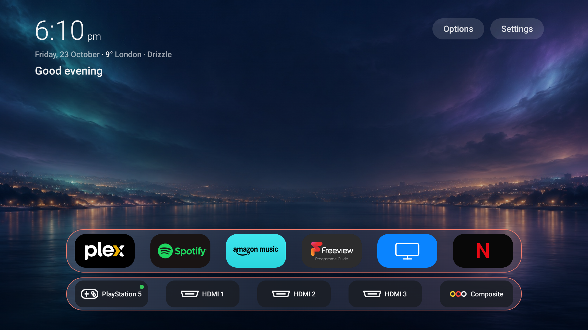
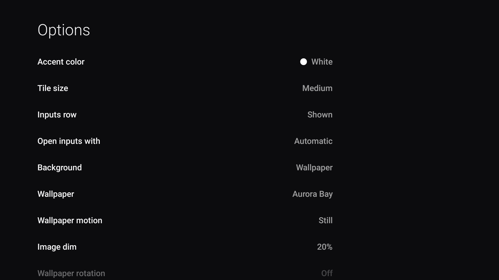
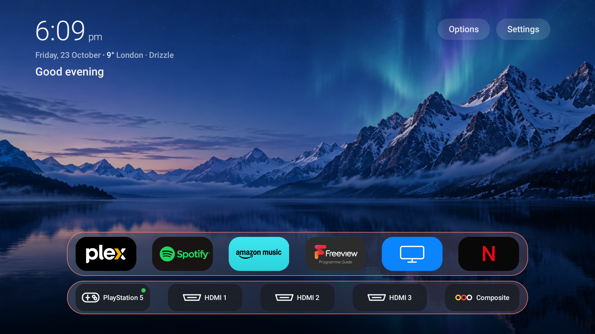

# Two-step AI installation guide

You do not need to understand ADB, Git, Android packages or terminal commands.
You only need to enable debugging on the TV and give its IP address to an AI agent.

The AI must be able to use the terminal on your computer. Good choices include
Codex, Claude Code, Cursor, Gemini CLI, or ChatGPT/Claude running in a coding or
computer-control mode. A normal browser chat without terminal access cannot reach
a TV on your home network.

## Step 1: turn on TV debugging

Keep the TV and computer connected to the same private home Wi-Fi network.

### Fire TV or a television with Fire OS

1. Open **Settings → My Fire TV** or **Device & Software → About**.
2. Highlight the TV/device name and press OK seven times.
3. Open **Developer Options** and turn **ADB debugging** on.
4. Open **About → Network** and write down the IP address.

On some Fire TV Edition televisions, the address is under **Settings → Network →
your connected Wi-Fi network**.

### Android TV or Google TV

1. Open **Settings → System → About**.
2. Highlight **Build** and press OK seven times.
3. Open **Developer options**.
4. Turn on **Wireless debugging** or **Network debugging**.
5. Write down the connection address shown by the TV.

Newer Android TVs may show an address with a port, for example
`192.168.x.x:12345`, plus a separate six-digit pairing code. Put the complete
address in the prompt. The AI will tell you when it needs the pairing code.

## Step 2: paste one prompt

Open your terminal-capable AI and paste the following. Replace only
`[TV IP ADDRESS]` with the address displayed by the TV.

```text
I own the TV at [TV IP ADDRESS]. ADB/Wireless debugging is already enabled and the
TV is on the same private network as this computer. Set it up using
https://github.com/mahirm380/TV-Debloater.

Do all of the computer work for me: download the repository, obtain Android ADB
from the official source if it is missing, connect to the TV, detect its model and
operating system, and read AGENTS.md and docs/AI-SETUP.md before changing anything.
Do not ask me to clone anything, install tools, or type terminal commands myself.

I want the Apple TV-style home screen shown in the repository. Keep Live TV, every
HDMI input, casting/AirPlay, the official app store, and all installed user apps.
Use safe defaults and leave remote-button remapping off unless I request it. Run a
read-only compatibility check first, show me a short summary, and ask once before
the first change. I will use the TV remote only to accept its debugging prompt or
choose dumbtv home if the TV asks.

Never root, flash, factory-reset, unlock the bootloader, write to /system, or guess
model-specific package removals. If this TV is not safely supported, stop and
explain why. When finished, configure the launcher, verify Home, apps, Live TV,
HDMI inputs and the app store, then give me the restore command.
```

That is all you need to type.

## What happens next

The AI will:

1. Download this repository and the official Android connection tool if needed.
2. Connect to the single IP address you supplied.
3. Detect the TV model, Android version and whether it runs Fire OS.
4. Stop safely if the platform cannot run the launcher.
5. Show a short read-only report and ask for one approval before changing the TV.
6. Install the checksum-verified launcher and configure the normal Home action.
7. Keep Live TV, HDMI, casting/AirPlay, the official store and user apps.
8. Configure weather after asking for your city, if you want it.
9. Test the result and give you the exact recovery command.

You may need to use the TV remote to:

- accept **Allow USB debugging?** and select **Always allow**;
- read a six-digit pairing code to the AI on newer Android TVs;
- choose **dumbtv home → Always** if Android displays a Home-app chooser;
- answer whether you want optional weather, Fire OS privacy cleanup or remote
  button changes.

You should not need to download files, install ADB, clone the project or enter
commands yourself.

## What the finished TV looks like

These are direct 1920×1080 screenshots from a TCL 50T6C-UK Fire TV, not mock-ups.

### Home screen



The launcher places apps and inputs near the bottom, keeps complete tiles visible,
and shows the selected app name. Time, date, weather and the time-aware greeting
remain easy to read without covering the wallpaper.

### Options and wallpapers

| Options | Alpine Aurora |
|---|---|
|  |  |

Options lets the owner change the accent, tile size, visible apps and inputs,
wallpaper, motion, dimming and rotation using only the TV remote.

## Supported televisions

| TV operating system | What the AI can do |
|---|---|
| Fire OS 6, 7 or 8 | Install the launcher; offer the reviewed reversible privacy cleanup |
| Android TV / Google TV 7.1+ | Install the launcher and request the normal Home role |
| Samsung Tizen, LG webOS, Roku, VIDAA or Saphi | Stop safely; these systems cannot run this Android APK |

Some Android brands do not permit a replacement Home app. The AI will leave the
stock launcher enabled and explain the limitation instead of forcing an unsafe
change.

## If the AI starts giving you commands

Paste this reply:

```text
Please run those commands yourself using your terminal tools. I will only approve
the prompt shown on the television and answer questions that cannot be detected.
```

If the AI has no terminal or computer tools, switch to Codex, Claude Code or
another coding-agent mode. A text-only chat cannot perform the installation.

## Undo with one prompt

Open the same AI in the project and paste:

```text
Restore my TV to its original home screen using this repository's documented safe
restore process. Connect only to [TV IP ADDRESS], inspect what this project changed,
show me the restore plan, ask once for approval, perform it, and verify the stock
Home screen works. Do not factory-reset, root, flash, or remove my user apps.
```

The individual advanced commands remain documented in
[the launcher reference](../launcher/README.md) and
[the troubleshooting guide](TROUBLESHOOTING.md), but ordinary users should not
need them.
